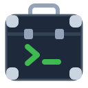

<p align="center">
  
</p>

<h1 align="center">roadie</h1>

<p align="center">
  <b>Tagelanges Basteln. Eine geführte Einrichtung.</b><br>
  Ein Terminal-Assistent, der aus einem frischen VPS deinen eigenen
  <a href="https://github.com/Viren070/AIOStreams">AIOStreams</a>- und Usenet-Streaming-Server macht.
</p>

<p align="center">
  <a href="https://github.com/usenetroadie/roadie/releases"></a>
  <a href="https://github.com/usenetroadie/roadie/actions/workflows/e2e.yml"></a>
  <a href="LICENSE"></a>
</p>

Du beantwortest ein paar Fragen: dein Usenet-Provider, dein Indexer, was du schauen willst. roadie
prüft jede Antwort, richtet den Server ein und gibt dir die Addon-Adresse für Stremio oder Nuvio.
Danach hält es den Server am Laufen und zeigt dir, wie er funktioniert, damit du selbst übernehmen
kannst.


## Warum es roadie gibt

Ich betreibe AIOStreams seit September auf meinem eigenen kleinen VPS, für ein paar Leute. Bis es
lief, hat es Tage gedauert: Reverse Proxy, ein echter Login vor den Einstellungsseiten, Provider auf
verschiedenen Backbones, eine Firewall, die mich nicht aussperrt, Backups, die sich zurückspielen
lassen. roadie ist dieses Setup als geführte Installation.

roadie entsteht mit viel Hilfe von Claude, einer KI. Was es einrichtet, kommt aus meinem eigenen
Betrieb, und jedes Release wird vor der Veröffentlichung automatisch auf allen unterstützten
Systemen installiert und geprüft.

Willst du lieber alles von Hand bauen, führt dich [Build it yourself](docs/manual-setup.md)
(englisch) Schritt für Schritt zum selben Server. Verschwände roadie morgen, liefe dein Server
weiter: Es ist ein ganz normales Docker-Compose-Setup, und `sudo roadie explain` zeigt, wie du es
ohne roadie pflegst.

## Was du bekommst

- AIOStreams mit eingebautem Usenet-Streaming und Prowlarr für deine Indexer, deine Sprachen
  zuerst, neue und vollständige Releases weiter oben
- Kataloge auf der Startseite und mit TMDB-Schlüssel dein eigenes [AIOMetadata](https://github.com/cedya77/aiometadata)
- eine Addon-Adresse pro Person, auf Wunsch mit eigenen Sprachen und eigener Qualität
- HTTPS auf einem kostenlosen DuckDNS-Namen oder deiner eigenen Domain, und ein Passkey-Login vor jeder Einstellungsseite
- SSH nur mit Schlüssel, eine Firewall, fail2ban und automatische Sicherheitsupdates
- Push-Meldungen, wenn etwas kaputtgeht, verschlüsselte wöchentliche Backups, Updates nur auf getestete Versionen
- `sudo roadie explain`: jeder Dienst, Port, jede Datei und jede geplante Aufgabe auf deinem Server, und warum

Nichts wird an irgendwen geschickt: keine Telemetrie.

## Schnellstart

Du brauchst einen frischen VPS mit Ubuntu 24.04, Debian 12 oder Debian 13 (x86_64 oder ARM64, 4 GB
RAM empfohlen), einen DuckDNS-Namen oder eine eigene Domain, einen Usenet-Provider und mindestens
einen Indexer. Noch nie einen Server gemietet? Siehe [Getting started](docs/getting-started.md) (englisch).

Melde dich auf dem Server an und führe aus:

```sh
curl -fsSL https://raw.githubusercontent.com/usenetroadie/roadie/main/get.sh | sudo bash
```

Das lädt die neueste Version, prüft Prüfsumme und Signatur, installiert sie und startet den
Assistenten. Bricht die Verbindung ab, starte `sudo roadie` erneut: Es macht dort weiter, wo es
aufgehört hat.

<details>
<summary>Stattdessen von Hand installieren</summary>

```sh
V=$(curl -fsSLI -o /dev/null -w '%{url_effective}' https://github.com/usenetroadie/roadie/releases/latest | sed 's|.*/||')
curl -fLO https://github.com/usenetroadie/roadie/releases/download/$V/roadie-$V.tar.gz
curl -fLO https://github.com/usenetroadie/roadie/releases/download/$V/roadie-$V.tar.gz.sha256
sha256sum -c roadie-$V.tar.gz.sha256          # muss "OK" ausgeben
tar xzf roadie-$V.tar.gz && cd roadie-$V
sudo bash install.sh && sudo roadie
```

</details>


Mehr zum Anschauen: der [Passkey-Login](assets/login.gif), die [AIOStreams-Konfiguration](assets/aiostreams.gif)
und die [AIOMetadata-Kataloge](assets/aiometadata.gif).

## Anleitungen

Die Anleitungen sind auf Englisch.

| Anleitung | Wofür |
|---|---|
| [Getting started](docs/getting-started.md) | VPS mieten, verbinden, was du vorbereiten musst |
| [Commands](docs/commands.md) | Befehle für den Alltag, das Menü, mehrere Personen |
| [Backups](docs/backups.md) | Backups, herunterladen, Umzug auf einen neuen Server |
| [Security](docs/security.md) | was geschützt ist und wie |
| [Troubleshooting](docs/troubleshooting.md) | keine Streams, Login-Probleme, Hilfe bekommen |
| [Build it yourself](docs/manual-setup.md) | derselbe Server von Hand, Schritt für Schritt |
| [Advanced](docs/advanced.md) | Antwort-Dateien, AIOStreams und Prowlarr selbst ändern, Deinstallieren |

## Grenzen

Nur Usenet. Es braucht einen VPS mit öffentlicher IPv4-Adresse; Hosting zu Hause hinter einem
Router geht noch nicht. Es ist eine frühe Version, die bisher wenige Leute nutzen.

## Hilfe

Fragen sind willkommen, auch kleine und gern auf Deutsch: [Issue öffnen](https://github.com/usenetroadie/roadie/issues/new/choose)
und die Ausgabe von `sudo roadie diagnose` anhängen (sie lässt Passwörter, Schlüssel, IP-Adressen
und deine Domain weg). Bitte frag hier und nicht in den Communitys von AIOStreams, Prowlarr,
Authelia oder Traefik: Sie kennen dieses Setup nicht. roadie ist ein Hobbyprojekt, eine Antwort
kann ein paar Tage dauern. Sicherheitsprobleme: siehe [SECURITY.md](SECURITY.md).

Änderungen stehen im [Changelog](CHANGELOG.md), wie du mitmachen kannst in
[CONTRIBUTING.md](CONTRIBUTING.md).

Aufgebaut auf [AIOStreams](https://github.com/Viren070/AIOStreams) von Viren070, [Traefik](https://traefik.io),
[Authelia](https://www.authelia.com), [Prowlarr](https://prowlarr.com), [age](https://age-encryption.org)
und [ntfy](https://ntfy.sh). roadie gehört zu keinem dieser Projekte, auch nicht zu Stremio oder Nuvio.

roadie installiert und konfiguriert nur Software. Es stellt keine Inhalte oder Quellen für Inhalte
bereit, listet oder empfiehlt sie nicht. Für die Nutzung und die Einhaltung der Gesetze deines
Landes und der Bedingungen der genutzten Dienste bist du selbst verantwortlich.

MIT-Lizenz, siehe [LICENSE](LICENSE). Die installierten Programme behalten ihre eigenen Lizenzen.
