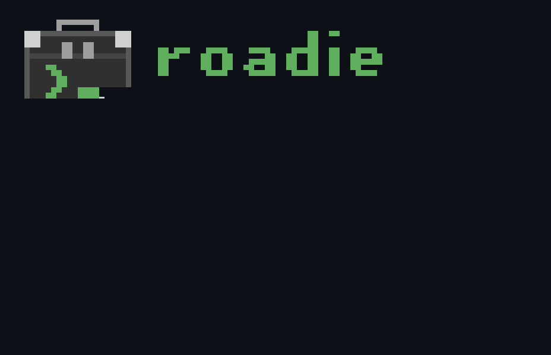
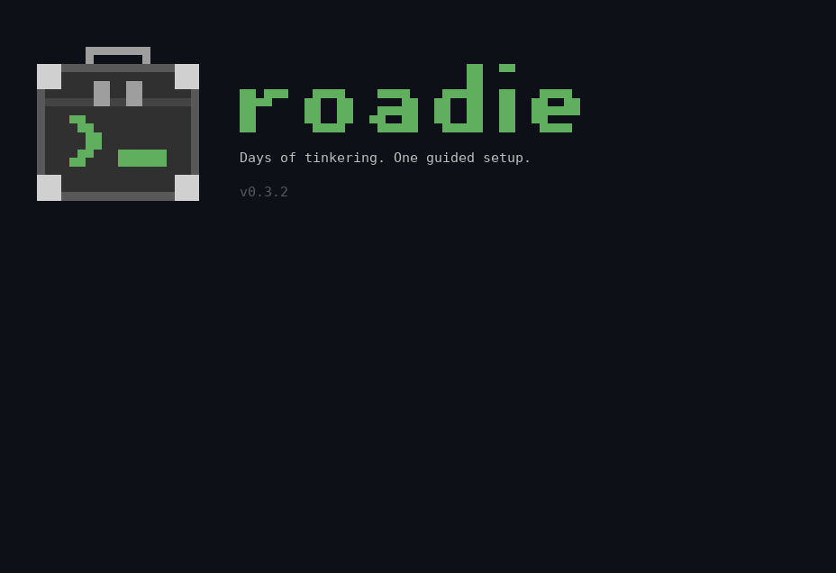
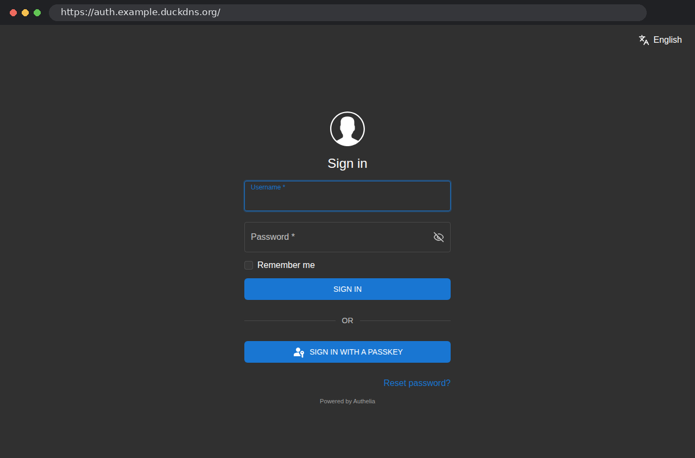
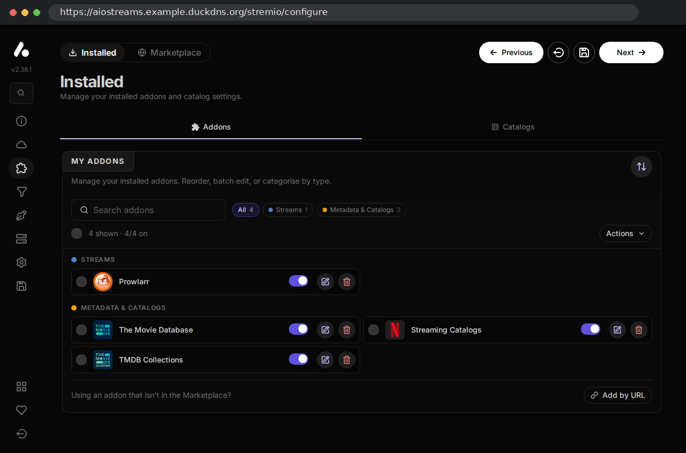
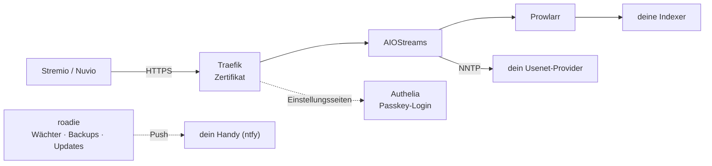

<p align="center">
  
</p>

<h1 align="center">roadie</h1>

<p align="center">
  <b>Tagelanges Basteln. Eine geführte Einrichtung.</b><br>
  Ein Terminal-Assistent, der aus einem frischen Ubuntu-VPS deinen eigenen, abgesicherten
  <a href="https://github.com/Viren070/AIOStreams">AIOStreams</a>- und Usenet-Streaming-Server macht.
</p>

<p align="center">
  <a href="https://github.com/usenetroadie/roadie/releases"></a>
  <a href="https://github.com/usenetroadie/roadie/actions/workflows/tests.yml"></a>
  <a href="LICENSE"></a>
  
</p>

<p align="center">
  <a href="#schnellstart">Schnellstart</a> ·
  <a href="#so-sieht-es-aus">Bilder</a> ·
  <a href="#funktionen">Funktionen</a> ·
  <a href="#anleitungen">Anleitungen</a> ·
  <a href="https://github.com/usenetroadie/roadie/issues">Issues</a> ·
  <a href="README.md">English</a>
</p>

Du beantwortest ein paar einfache Fragen – dein Usenet-Provider, dein Indexer, was du schauen
willst. roadie prüft jede Antwort sofort, richtet alles ein und gibt dir am Ende die
Addon-Adresse für Stremio oder Nuvio.



<p align="center"><sub>Frühe Version · nur Usenet · braucht einen frischen VPS</sub></p>

## Warum es roadie gibt

Ich betreibe genau dieses Setup auf meinem eigenen kleinen VPS. Bis es lief, hat es Tage gedauert:
Reverse Proxy, ein echter Login vor jeder Einstellungsseite, Usenet-Provider auf verschiedenen
Backbones, eine Firewall, die mich nicht aussperrt, Backups, die sich wirklich zurückspielen lassen.
roadie ist alles, was ich dabei gelernt habe, in einer geführten Einrichtung – damit die Nächsten
eine halbe Stunde brauchen statt eines Wochenendes. Und es macht dich nicht abhängig: AIOStreams
und Prowlarr kannst du jederzeit selbst öffnen und anpassen.

## Funktionen

**Streaming**
- AIOStreams mit eingebautem Usenet-Streaming direkt von deinem Provider, Prowlarr für deine Indexer
- Deine Sprachen zuerst, Ranking zugunsten neuer und vollständiger Releases, Failover, nächste Folge vorgeladen
- Kataloge auf der Startseite ab Werk (Trends, Netflix / Prime / Disney+, Filmreihen)
- Eine Addon-Adresse pro Person, auf Wunsch mit eigenen Sprachen und eigener Qualität

**Sicherheit**
- Eigene Adresse (DuckDNS) mit HTTPS von Let's Encrypt
- Login mit Passkey oder Code-App (Authelia) vor jeder Einstellungsseite – deine Player-Apps funktionieren weiter
- SSH-Login per Schlüssel; der Passwort-Login wird erst abgeschaltet, nachdem dein Schlüssel-Login gesehen wurde, damit du dich nicht versehentlich aussperrst
- Firewall, fail2ban (auch für Docker-Ports), automatische Sicherheitsupdates

**Wartung**
- Push-Meldungen aufs Handy (ntfy), wenn etwas nicht stimmt
- Verschlüsselte wöchentliche Backups (age), Wiederherstellung auf einem neuen Server mit einem Befehl
- `sudo roadie update` installiert nur getestete Versionen aus signierten Releases
- Ein Menü für den Alltag: Zugänge, Login-Code, Neustart, Personen, Hilfe

Alles läuft auf deinem eigenen Server. roadie schickt nichts an seine Entwickler – keine Telemetrie.

## Schnellstart

**Du brauchst:**
- einen frischen VPS mit **Ubuntu 24.04 (x86_64)**, 2 vCPU, 4 GB RAM empfohlen (mindestens 2 GB), 20 GB Speicher, sonst nichts darauf
- eine kostenlose [DuckDNS](https://www.duckdns.org)-Subdomain und ihr Token
- Zugangsdaten eines Usenet-Providers und mindestens einen Usenet-Indexer (API-Adresse + Schlüssel)
- optional: die App ntfy für Push-Meldungen, einen TMDB-API-Schlüssel

Noch nie einen Server gemietet? [Getting started](docs/getting-started.md) (englisch) führt dich durch.

**Installation** – melde dich auf deinem Server an und führe aus:

```sh
V=$(curl -fsSL https://api.github.com/repos/usenetroadie/roadie/releases/latest | grep -oP '"tag_name": "\K[^"]+')
curl -fLO https://github.com/usenetroadie/roadie/releases/download/$V/roadie-$V.tar.gz
curl -fLO https://github.com/usenetroadie/roadie/releases/download/$V/roadie-$V.tar.gz.sha256
sha256sum -c roadie-$V.tar.gz.sha256          # muss "OK" ausgeben
tar xzf roadie-$V.tar.gz && cd roadie-$V
sudo bash install.sh && sudo roadie
```

Bricht die Verbindung ab oder geht etwas schief, starte einfach erneut `sudo roadie` – es macht
dort weiter, wo es aufgehört hat. Der Assistent spricht Deutsch, wenn du es am Anfang auswählst.



## So sieht es aus

<table>
  <tr>
    <td width="50%"><a href="assets/login.gif"></a></td>
    <td width="50%"><a href="assets/aiostreams.gif"></a></td>
  </tr>
  <tr>
    <td><b>Anmelden mit einem Tipp.</b> Die Einstellungsseiten liegen hinter deinem eigenen Login – mit Passkey per Face ID oder Fingerabdruck. <a href="assets/login.gif">Ansehen</a></td>
    <td><b>AIOStreams fertig eingerichtet.</b> Prowlarr, Kataloge, deine Sprachen und eine Stream-Grenze. Ändere auf der Website, was du willst; roadie behält deine Änderungen. <a href="assets/aiostreams.gif">Ansehen</a></td>
  </tr>
</table>

## So funktioniert es



Alle Dienste laufen in Docker auf deinem Server. Von außen erreichbar ist nur Traefik (Ports 80/443).
Dein Player fragt AIOStreams nach Streams; AIOStreams sucht über Prowlarr bei deinen Indexern und
streamt die Datei direkt von deinem Usenet-Provider. Mehr dazu: [Security](docs/security.md).

## Anleitungen

Die ausführlichen Anleitungen gibt es auf Englisch:

| Anleitung | Inhalt |
|---|---|
| [Getting started](docs/getting-started.md) | VPS mieten, verbinden, was du vorbereitest, erste Schritte nach der Einrichtung |
| [Commands](docs/commands.md) | Befehle im Alltag, das Menü, mehrere Personen |
| [Backups](docs/backups.md) | Backups, herunterladen, Umzug auf einen neuen Server |
| [Security](docs/security.md) | was wie geschützt ist, signierte Updates |
| [Troubleshooting](docs/troubleshooting.md) | keine Streams, Login-Probleme, Hilfe bekommen |
| [Advanced](docs/advanced.md) | Antwortdateien, AIOStreams und Prowlarr selbst anpassen, mehr Kataloge, Deinstallieren |

Die wichtigsten Befehle: `sudo roadie` (Menü), `sudo roadie status`, `sudo roadie backup`,
`sudo roadie update`, `sudo roadie diagnose`, `sudo roadie uninstall`. Die deutschen Kurzformen
`zugang`, `personen`, `neustart`, `hilfe` und `deinstallieren` funktionieren auch.

## Aktuelle Grenzen

- nur Ubuntu 24.04 auf x86_64 (noch kein ARM)
- nur DuckDNS-Adresse (noch keine eigene Domain)
- nur Usenet
- ein Server pro Setup

## Hilfe, Mitmachen, Dank

- **Probleme:** führe `sudo roadie diagnose` aus und häng die Ausgabe an ein [Issue](https://github.com/usenetroadie/roadie/issues/new/choose). Passwörter, Schlüssel, IP-Adressen und deine Domain werden entfernt; lies die Ausgabe trotzdem einmal, bevor du sie postest.
- **Sicherheitsprobleme:** bitte kein öffentliches Issue – siehe [SECURITY.md](SECURITY.md).
- **Mitmachen:** siehe [CONTRIBUTING.md](CONTRIBUTING.md).
- **Dank an:** [AIOStreams](https://github.com/Viren070/AIOStreams) von Viren070, [Traefik](https://traefik.io),
  [Authelia](https://www.authelia.com), [Prowlarr](https://prowlarr.com), [age](https://age-encryption.org),
  [ntfy](https://ntfy.sh). Usenet-Backbone-Daten: [usenetalmanac.com](https://usenetalmanac.com) /
  usenet.rexum.space Community-Karte. roadie gehört zu keinem dieser Projekte, auch nicht zu Stremio oder Nuvio.

**Verantwortung:** roadie installiert und konfiguriert nur Software. Es stellt keine Inhalte oder
Quellen für Inhalte bereit, listet oder empfiehlt sie nicht. Du bist selbst dafür verantwortlich,
wie du die Software nutzt, und für die Einhaltung der Gesetze deines Landes und der Bedingungen der
Dienste, die du nutzt.

**Lizenz:** MIT – siehe [LICENSE](LICENSE). Die installierten Programme behalten ihre eigenen Lizenzen.
