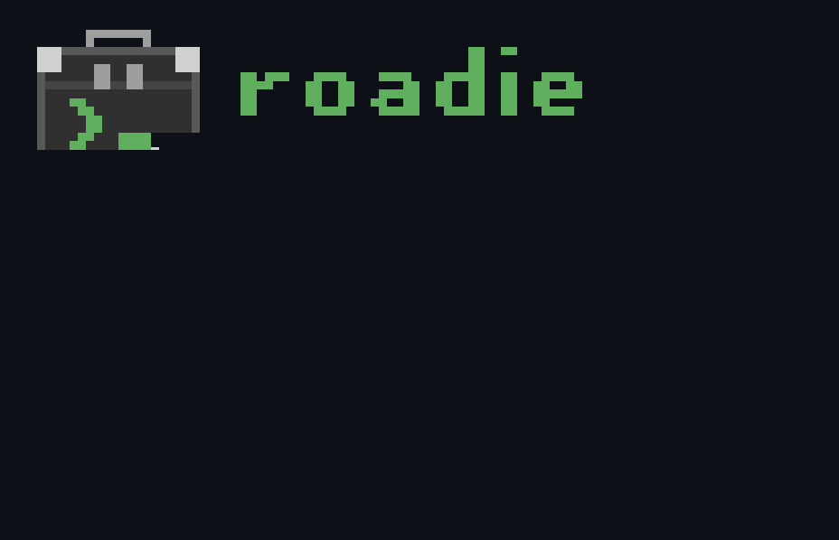
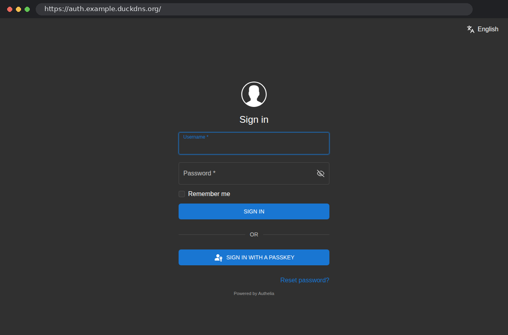
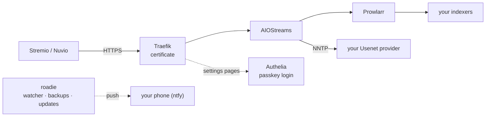

<p align="center">
  
</p>

<h1 align="center">roadie</h1>

<p align="center">
  <b>Days of tinkering. One guided setup.</b><br>
  A terminal wizard that turns a fresh VPS into your own secure
  <a href="https://github.com/Viren070/AIOStreams">AIOStreams</a> + Usenet streaming server.
</p>

<p align="center">
  <a href="https://github.com/usenetroadie/roadie/releases"></a>
  <a href="https://github.com/usenetroadie/roadie/actions/workflows/tests.yml"></a>
  <a href="LICENSE"></a>
  
  
  
</p>

<p align="center">
  <a href="#quick-start">Quick start</a> ·
  <a href="#what-it-looks-like">Screenshots</a> ·
  <a href="#features">Features</a> ·
  <a href="#documentation">Docs</a> ·
  <a href="https://github.com/usenetroadie/roadie/issues">Issues</a> ·
  <a href="README.de.md">Deutsch</a>
</p>

You answer a few plain questions – your Usenet provider, your indexer, what you like to watch.
roadie checks every answer right away, sets everything up, and ends with the addon address you
paste into Stremio or Nuvio.



<p align="center"><sub>Early release · Usenet only · needs a fresh VPS</sub></p>

## Why I built roadie

I run this setup on my own small VPS. Getting there took days: a reverse proxy, a real login in
front of every settings page, Usenet providers on different backbones, a firewall that does not
lock me out, backups that actually restore. roadie is everything I learned, packed into one guided
setup – so the next person spends half an hour instead of a weekend. And it does not lock you in:
AIOStreams and Prowlarr stay yours to open and change.

## Features

**Streaming**
- AIOStreams with built-in Usenet streaming straight from your provider, Prowlarr for your indexers
- Your languages first, ranking that prefers recent and complete releases, failover, next episode preloaded
- Catalogs on the start page out of the box (trending, Netflix / Prime / Disney+, collections)
- One addon address per person, each with their own languages and quality if wanted

**Security**
- Your own address – a free DuckDNS name or your own domain – with HTTPS from Let's Encrypt
- Passkey or code app login (Authelia) in front of every settings page – your player apps keep working
- SSH key login; password login is only switched off after your key login was seen, so you do not lock yourself out by accident
- Firewall, fail2ban (also for Docker ports), automatic security updates

**Maintenance**
- Push messages to your phone (ntfy) when something breaks
- Encrypted weekly backups (age) with a one-command restore on a new server
- `sudo roadie update` installs only tested versions, from signed releases
- A menu for everyday things: access details, login code, restart, people, help

Everything runs on your own server. roadie sends nothing to its authors – no telemetry.

## Quick start

**You need:**
- a fresh VPS with **Ubuntu 24.04, Debian 12 or Debian 13** – x86_64 or **ARM64** (e.g. the Oracle Cloud free tier) –
  2 vCPU, 4 GB RAM recommended (2 GB minimum), 20 GB disk, nothing else on it
- a web address: a free [DuckDNS](https://www.duckdns.org) subdomain and its token, **or your own domain**
  (roadie tells you which DNS entries to create)
- a Usenet provider login and at least one Usenet indexer (API address + key)
- optional: the ntfy app for push messages, a TMDB API key

Never rented a server? [Getting started](docs/getting-started.md) walks you through it.

**Install** – log in to your server and run:

```sh
V=$(curl -fsSL https://api.github.com/repos/usenetroadie/roadie/releases/latest | grep -oP '"tag_name": "\K[^"]+')
curl -fLO https://github.com/usenetroadie/roadie/releases/download/$V/roadie-$V.tar.gz
curl -fLO https://github.com/usenetroadie/roadie/releases/download/$V/roadie-$V.tar.gz.sha256
sha256sum -c roadie-$V.tar.gz.sha256          # must print "OK"
tar xzf roadie-$V.tar.gz && cd roadie-$V
sudo bash install.sh && sudo roadie
```

If the connection drops or something fails, run `sudo roadie` again – it picks up where it left off.


## What it looks like

<table>
  <tr>
    <td width="50%"><a href="assets/login.gif"></a></td>
    <td width="50%"><a href="assets/aiostreams.gif"></a></td>
  </tr>
  <tr>
    <td><b>One tap to sign in.</b> Settings pages sit behind your own login – with a passkey it is Face ID or a fingerprint. <a href="assets/login.gif">Watch it</a></td>
    <td><b>Ready-made AIOStreams.</b> Prowlarr, catalogs, your languages and a stream limit. Change anything on the website; roadie keeps your changes. <a href="assets/aiostreams.gif">Watch it</a></td>
  </tr>
</table>

## How it works



All services run in Docker on your server. Only Traefik is reachable from outside (ports 80/443).
Your player asks AIOStreams for streams; AIOStreams searches your indexers through Prowlarr and
streams the file directly from your Usenet provider. More: [Security](docs/security.md).

## Documentation

| Guide | For |
|---|---|
| [Getting started](docs/getting-started.md) | renting a VPS, connecting, what to prepare, first steps after the setup |
| [Commands](docs/commands.md) | everyday commands, the menu, several people |
| [Backups](docs/backups.md) | backups, downloading them, moving to a new server |
| [Security](docs/security.md) | what is protected and how, signed updates |
| [Troubleshooting](docs/troubleshooting.md) | no streams, login problems, getting help |
| [Advanced](docs/advanced.md) | answers files, adjusting AIOStreams and Prowlarr yourself, more catalogs, uninstall |

## Current limitations

- Usenet only
- Needs a server with a public IPv4 address (a VPS); hosting at home behind a router is not supported
- One server per setup

## Help, contributing, credits

- **Problems:** run `sudo roadie diagnose` and attach the output to an [issue](https://github.com/usenetroadie/roadie/issues/new/choose). It removes passwords, keys, IP addresses and your domain; still read it once before posting.
- **Security problems:** please do not open a public issue – see [SECURITY.md](SECURITY.md).
- **What changed:** see [CHANGELOG.md](CHANGELOG.md).
- **Contributing:** see [CONTRIBUTING.md](CONTRIBUTING.md).
- **Credits:** [AIOStreams](https://github.com/Viren070/AIOStreams) by Viren070, [Traefik](https://traefik.io),
  [Authelia](https://www.authelia.com), [Prowlarr](https://prowlarr.com), [age](https://age-encryption.org),
  [ntfy](https://ntfy.sh). Usenet backbone data: [usenetalmanac.com](https://usenetalmanac.com) /
  usenet.rexum.space community map. roadie is not affiliated with any of them, nor with Stremio or Nuvio.

**Responsibility:** roadie only installs and configures software. It does not provide, list or
recommend any content or sources of content. You are responsible for how you use the software and
for complying with the laws of your country and the terms of the services you use.

**License:** MIT – see [LICENSE](LICENSE). The installed programs keep their own licenses.
