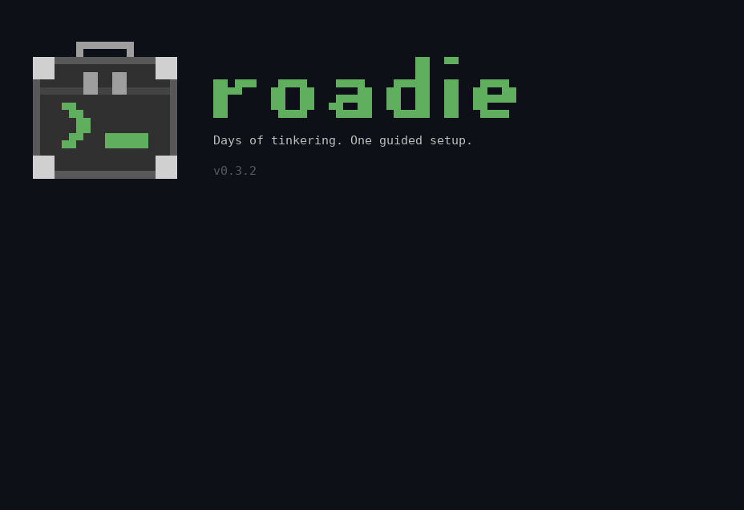
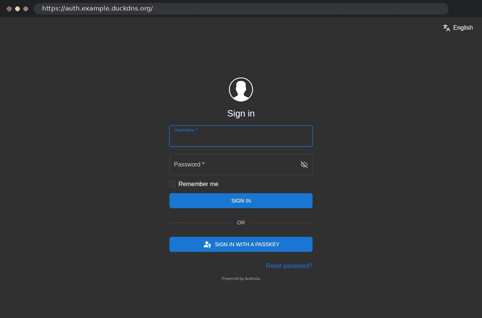
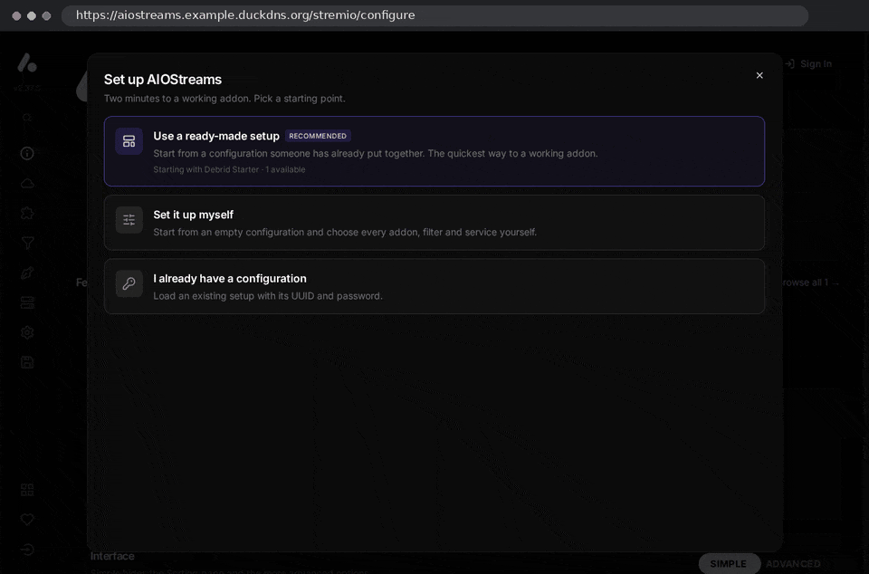

# roadie

*Your streaming roadie: it sets up the stage and keeps the show running.*

**English** · [Deutsch](README.de.md)

A terminal wizard that turns a **fresh Ubuntu 24.04 server** into a secure, self-hosted
[AIOStreams](https://github.com/Viren070/AIOStreams) server for Stremio and Nuvio that streams from
**Usenet** – from your answers, not from a template you have to edit by hand.

You answer simple questions (language, Usenet provider and indexer, keys, what you want to watch). The
wizard checks every answer right away, sets everything up, and ends with the addon address you
paste into Stremio or Nuvio.


> **Status: early test version.** Fully tested in automated runs on fresh Ubuntu 24.04 machines,
> but not yet by many people on real servers. Please report problems (see *Getting help*).

**Limits today:** Ubuntu 24.04 on x86_64 only (no ARM yet) · DuckDNS address only (no own domain
yet) · Usenet only · one server per setup.

## What you get

- **Secured server:** admin user with SSH key, password and root login switched off only after a
  key login was confirmed (you cannot lock yourself out), firewall, protection against login
  attacks and web scanners (fail2ban, also for Docker ports), automatic security updates with
  restart at night only when needed.
- **Your own address** via DuckDNS with an HTTPS certificate (Let's Encrypt).
- **AIOStreams** with Usenet (Prowlarr as indexer manager, built-in Usenet streaming straight
  from your provider), sensible defaults (cache, ranking that prefers recent and complete releases,
  failover, next episode preloading), your languages in your order.
- **Login protection** (Authelia: password + passkey or code app) in front of every settings
  page, while your player apps keep working.
- **Operations:** push messages to your phone (ntfy), a watcher for services, reachability,
  certificate, disk, memory and SSH logins, **encrypted weekly backups** (age) with a restore
  command, login status, tested updates.

Everything runs on your own server. roadie sends nothing to its authors – no telemetry.

## Before you start

You need a small server that is yours alone. If you have never rented one:

1. Rent a **VPS** (a virtual server) from any server provider. Choose **Ubuntu 24.04**, **x86_64**,
   at least **2 vCPU**, **4 GB RAM** (recommended) and **20 GB** of storage. Nothing else should run on it.
2. The provider shows you an **IP address** and a **username** (often `root` or `ubuntu`) and
   either a password or lets you add an SSH key.
3. **Connect the first time:** on a phone use an SSH app such as Termius; on a PC or Mac open a
   terminal and type `ssh USER@IP-ADDRESS` (for example `ssh root@203.0.113.10`), using the
   username from your provider. Confirm the question with `yes` and enter the password.
4. Now you are on the server. Continue with *Install* below and run the install command there.

## Requirements

- A **fresh** VPS with **Ubuntu 24.04 LTS (x86_64)**, at least 2 CPU cores, 2 GB RAM (4 GB
  recommended), 20 GB disk. Nothing else should run on it.
- A free [DuckDNS](https://www.duckdns.org) subdomain and its token.
- A Usenet provider login and at least one Usenet indexer (API address + key).
- Optional: your own SSH key – if you have none, the wizard creates one and shows it once.
- Optional: the ntfy app for push messages, a TMDB API key.

## Install

Log in to your new server and run:

```sh
# 1. download a release (replace VERSION) and its checksum
curl -fLO https://github.com/usenetroadie/roadie/releases/download/VERSION/roadie-VERSION.tar.gz
curl -fLO https://github.com/usenetroadie/roadie/releases/download/VERSION/roadie-VERSION.tar.gz.sha256
# 2. verify it – must print "OK"
sha256sum -c roadie-VERSION.tar.gz.sha256
# 3. unpack, install, start
tar xzf roadie-VERSION.tar.gz && cd roadie-VERSION
sudo bash install.sh
sudo roadie
```

`git clone` works too: `git clone https://github.com/usenetroadie/roadie && cd roadie && sudo bash install.sh`.

roadie needs nothing but what Ubuntu already has (Python 3). It installs Docker, the
services and a few system packages from the official sources itself, in fixed, tested versions.

If the connection drops or something fails, simply start `sudo roadie` again – it picks up
where it left off.



**How updates are verified:** `sudo roadie update` first looks for a newer roadie
release. It installs it only if the checksum matches *and* the release carries a valid signature
from the project's release key (OpenSSH `ssh-keygen -Y verify`; the public key is built into
roadie). The new version must start before it replaces the old one; the old one stays in
`/opt/roadie/app.prev`. If anything fails, nothing changes. To go back by hand: `sudo rm -rf /opt/roadie/app && sudo mv /opt/roadie/app.prev /opt/roadie/app`.

## After the setup

The settings pages sit behind your own login. With a passkey it is one tap (Face ID, fingerprint):



Your AIOStreams configuration is ready to use – Prowlarr, catalogs, your languages and a stream
limit. Change anything you like on the website; roadie keeps your changes:



## Everyday commands

| Command | What it does |
|---|---|
| `sudo roadie` | set up, continue, or change settings |
| `sudo roadie status` | short status (also shown at every SSH login) |
| `sudo roadie backup` | encrypted backup now (also runs every Sunday night) |
| `sudo roadie restore FILE --identity KEYFILE` | restore a backup on a fresh server, then run `sudo roadie` |
| `sudo roadie update` | update roadie itself, then install the tested service versions (backup first) |
| `sudo roadie diagnose` | problem report without secrets, IP addresses or your domain |
| `sudo roadie uninstall` | remove everything the wizard set up (asks first, offers a last backup; admin user, SSH protection, backups and Docker stay) |

After the setup, `sudo roadie` opens a menu: *Show my access details* (all addresses and logins you
need again), the login confirmation code, status, *Restart services*, *Manage people*, *Change settings*,
backup, updates and help
(including *Adjust it yourself*: how to change things in AIOStreams without the wizard
overwriting them – it only rewrites its own sections). Shortcuts:

| Shortcut | Opens |
|---|---|
| `sudo roadie access` | Show my access details |
| `sudo roadie code` | the login confirmation code |
| `sudo roadie people` | Manage people |
| `sudo roadie restart` | restart services (starts stopped ones; AIOStreams reads new indexers) |
| `sudo roadie help` | help pages |

**Several people:** everyone gets their own addon address. A person either inherits the main
settings or has their own languages and quality. *Change settings* keeps the people as they are (change
them under *Manage people*). In an answers file `people` is optional: without it the stored people stay;
people left out of the list are removed and their addon address stops working. The setup ends with a test search that shows your
setup really finds streams; the login message at every SSH login points to `sudo roadie`.

## Backups

Backups are encrypted with [age](https://age-encryption.org). Only the **public** key is stored on
the server; the **private** key stays with you (the wizard creates one and shows it once if you
have none). Download the files from `~/backups` of your admin user, e.g. with an SFTP app.

To move to a new server: install roadie there, run `sudo roadie restore` with your
backup and private key, then `sudo roadie` → *Continue / check everything again*. Your addon address stays the same.

## Unattended setup

For automation, all answers can come from a file: `sudo roadie setup --answers answers.json`
(see `examples/answers.example.json`). `--dry-run` only checks answers and server.

## Getting help

Run `sudo roadie diagnose` and attach the output to a GitHub issue. It removes passwords,
keys, IP addresses and your domain; still read it once before posting.

## Security problems

Found a security problem? Please do not open a public issue – see [SECURITY.md](SECURITY.md).

## Responsibility

roadie only installs and configures software. It does not provide, list or recommend any
content or sources of content. You are responsible for how you use the software and for
complying with the laws of your country and the terms of the services you use.

## License

MIT – see [LICENSE](LICENSE). AIOStreams, Traefik, Authelia, Prowlarr and the other installed
programs keep their own licenses. Usenet backbone data: [usenetalmanac.com](https://usenetalmanac.com)
/ usenet.rexum.space community map.

## Development

```sh
python3 -m unittest discover -s tests      # unit tests, standard library only
```

End-to-end tests run the whole wizard on a fresh machine: see `tests/e2e/README.md` and
`.github/workflows/e2e.yml`. Component versions live in `roadie/data/versions.json`; a
version is only raised after the end-to-end run passed with it.
